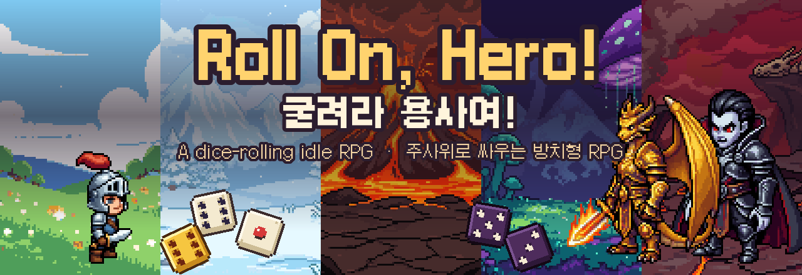
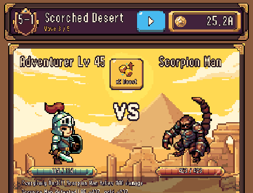
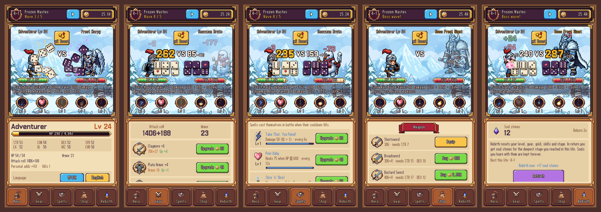
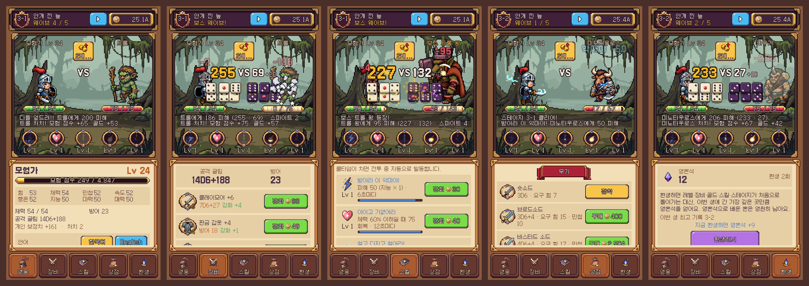

<p align="center">
  
</p>

<p align="center">
  <b>A dice-rolling idle RPG</b> · <b>주사위로 싸우는 방치형 RPG</b><br>
  <a href="https://play.google.com/store/apps/details?id=com.trialmobile.rollonhero"><b>Google Play</b></a> · <a href="https://gamebyul.itch.io/roll-on-hero"><b>itch.io</b></a> · <a href="https://isirinz.github.io/roll-on-hero/">Website</a> · <a href="#english">English</a> · <a href="#한국어">한국어</a> · <a href="https://isirinz.github.io/roll-on-hero/privacy/">Privacy</a>
</p>

<p align="center">
  
  
  
  
</p>

<p align="center">
  
</p>

---

## English

### Every swing is a roll of the dice

**Roll On, Hero!** is a pixel-art idle RPG for phones built on old-school tabletop rules. Your hero fights on their own. Every round, the hero and the monster each throw a fistful of six-sided dice, and you watch them tumble, bounce and land. The higher total hits, armor soaks part of the blow, and every 6 you roll bites through anyway. You decide how to grow: better gear, stronger spells, and when the road gets too hard, a fresh life with souls that make the next one easier.

### Features

- **Real dice combat.** Both sides roll their attack dice on screen. Higher hit total wins the round, the difference is damage, armor absorbs some of it, and each 6 deals 1 point of *spite damage* that ignores armor.
- **10 chapters, 50 monsters.** Green meadows, a haunted graveyard, a frozen waste, a desert, a volcano, a mushroom forest, a shipwreck coast, a shadow castle and the dragon's peak. Each chapter has its own background, 4 regular monsters and a boss. 10 stages per chapter, 5 waves per stage.
- **5 auto-cast spells** with silly names: *Take That, You Fiend!*, *Poor Baby*, *Slice 'n' Dice!*, *Kaboom, Baby!* and *Everybody Duck!!*
- **19 weapons, armors and shields**, each with its own icon. Buy them, meet their strength and dexterity requirements, and enhance them with gold.
- **Rebirth.** Reach chapter 2 and you can start over for soul stones. The deeper you went, the more you get. Spend them on four permanent souls: more hit total, more gold, more adventure points, and +1 to every attribute.
- **x2 Boost.** Double attack and gold for 15 minutes, once every 2 hours. It is built to be unlocked by a rewarded ad later. For now it is free.
- **Idle progress.** Close the game and the hero keeps fighting. Rewards count up to 2 hours at first, plus 1 hour for every new chapter you reach (up to 12 hours, kept after rebirth). You get a summary when you come back.
- **English and Korean**, switchable in game. English uses a narrower pixel font so long names fit.
- **Battle speed** x1 / x2 / x3, and 23 retro sound effects (can be turned off in the hero tab).

### Screenshots

<p align="center"></p>

### How to play

1. Watch the hero fight. Gold and adventure points (AP) come in on their own.
2. **Gear** tab: enhance your weapon, armor and shield.
3. **Shop** tab: buy better gear when your strength and dexterity are high enough.
4. **Spells** tab: spells unlock at Lv 1, 3, 5, 8 and 15. Upgrade them with gold.
5. Lost to a boss? The hero trains on earlier waves until they level up, then tries again. You can also press **Retry**.
6. Stuck? **Rebirth** for soul stones and come back stronger.

### Build and run

You need JDK 17 or newer. The Gradle wrapper is included.

```bash
./gradlew lwjgl3:run          # play on desktop
./gradlew lwjgl3:jar          # runnable jar in lwjgl3/build/libs
./gradlew android:installDebug # install on a connected Android device (needs the Android SDK)
./gradlew core:test           # unit tests for the rules, saves and shop
```

---

## 한국어

### 휘두를 때마다 주사위를 굴린다

**굴려라 용사여!**는 옛날 테이블탑 RPG 규칙으로 싸우는 모바일 픽셀아트 방치형 RPG입니다. 영웅은 알아서 싸웁니다. 라운드마다 영웅과 몬스터가 6면체 주사위를 한 움큼씩 던지고, 화면 위에서 주사위가 구르고 튀어 오르다 멈춥니다. 합이 높은 쪽이 때리고, 방어구가 피해를 일부 막고, 6이 나오면 방어구를 뚫고 들어갑니다. 무엇을 키울지는 플레이어가 정합니다. 더 좋은 장비, 더 강한 스킬, 그리고 길이 막히면 영혼을 안고 다시 태어나는 환생까지.

### 특징

- **진짜 주사위 전투.** 양쪽이 공격 주사위를 화면에 직접 던집니다. 타격 총합이 높은 쪽이 이기고, 차이만큼 피해를 주며, 방어구가 일부를 흡수합니다. 6이 하나 나올 때마다 방어구를 무시하는 *스파이트 피해* 1점이 들어갑니다.
- **10개 챕터, 몬스터 50종.** 초록 들판, 묘지, 설원, 사막, 화산, 버섯 숲, 난파선 해안, 어둠의 성, 용의 봉우리까지. 챕터마다 배경이 다르고 일반 몬스터 4종과 보스 1종이 나옵니다. 챕터당 스테이지 10개, 스테이지당 웨이브 5개.
- **자동으로 터지는 스킬 5종.** *받아라 이 악마야!*, *아이고 가엾어라*, *썰고 다지고 썰어라!*, *펑! 하고 터져라*, *다들 엎드려!!*
- **무기·갑옷·방패 19종**, 하나하나 다른 아이콘. 상점에서 사고, 힘·민첩 조건을 채우면 장착하고, 골드로 강화합니다.
- **환생.** 챕터 2에 도달하면 처음부터 다시 시작하는 대신 영혼석을 받습니다. 깊이 갈수록 많이 받습니다. 영혼석으로 영구 특성(혼) 4종을 배웁니다. 타격 총합, 골드, 모험 점수가 늘어나고 모든 능력치가 +1씩 오릅니다.
- **2배 버프.** 15분 동안 공격력과 골드가 2배, 2시간마다 한 번. 나중에 보상형 광고로 켜도록 만들어 두었고, 지금은 그냥 켜집니다.
- **방치 진행.** 게임을 꺼 두어도 영웅이 계속 싸우고, 돌아오면 결과를 정산해 줍니다. 처음엔 2시간까지 인정되고, 새 챕터에 갈 때마다 1시간씩 늘어 최대 12시간까지(환생해도 유지).
- **한국어·영어** 지원, 게임 안에서 바로 전환. 영어에서는 긴 이름이 들어가도록 좁은 픽셀 글꼴을 씁니다.
- **배속** 1/2/3배, 레트로 효과음 23종(영웅 탭에서 끌 수 있음).

### 스크린샷

<p align="center"></p>

### 플레이 방법

1. 영웅이 싸우는 것을 지켜보세요. 골드와 모험 점수가 저절로 쌓입니다.
2. **장비** 탭에서 무기·방어구·방패를 강화합니다.
3. **상점** 탭에서 힘·민첩이 충분하면 더 좋은 장비를 삽니다.
4. **스킬** 탭: 스킬은 Lv 1, 3, 5, 8, 15에 해금되고 골드로 강화합니다.
5. 보스에게 졌다면 영웅이 앞 웨이브에서 힘을 기르다 레벨이 오르면 다시 도전합니다. **다시 도전** 버튼으로 바로 도전할 수도 있습니다.
6. 막혔다면 **환생**해서 영혼석을 받고 더 강해져서 돌아오세요.

### 빌드와 실행

JDK 17 이상이 필요합니다. Gradle 래퍼가 들어 있습니다.

```bash
./gradlew lwjgl3:run          # 데스크톱에서 실행
./gradlew lwjgl3:jar          # 실행 가능한 jar (lwjgl3/build/libs)
./gradlew android:installDebug # 연결된 안드로이드 기기에 설치 (Android SDK 필요)
./gradlew core:test           # 규칙·저장·상점 단위 테스트
```

---

## For developers

| Module | What it is |
|---|---|
| `core` | All game code. `rules/` and `battle/` are pure Java (no libGDX), so combat, saves, rebirth and offline progress are unit-tested. |
| `lwjgl3` | Desktop launcher (450×800 window). |
| `android`, `ios` | Mobile launchers (portrait). |
| `assets/` | Sprites, chapter backgrounds, UI, item icons, sound effects, fonts, `i18n/strings*.properties`. |
| `tools/` | Asset pipelines: `sprites/` converts PixelLab characters and effects, `ui-assets/` builds the UI nine-patches, `sfx/make_sfx.py` synthesizes every sound effect from code. |

- **Combat** happens in `battle/BattleSystem` on integer milliseconds, so real-time play and offline fast-forward give the same results.
- **Text** lives in `assets/i18n/strings.properties` (English) and `strings_ko.properties` (Korean). A test checks that both files have the same keys.
- **Rewarded ads** plug in through `ads/RewardedAds`. Implement it in the Android or iOS launcher and call `game.setRewardedAds(...)`.
- `CLAUDE.md` has detailed notes on architecture, layout rules and asset conventions.

## Credits

- Built with [libGDX](https://libgdx.com/) (Apache 2.0), project created with [gdx-liftoff](https://github.com/libgdx/gdx-liftoff).
- Pixel art (characters, monsters, backgrounds, icons, UI, effects) made with [PixelLab](https://www.pixellab.ai/).
- Fonts: [Galmuri](https://github.com/quiple/galmuri) by Lee Minseo (quiple), SIL Open Font License 1.1 (`assets/fonts/Galmuri-OFL.txt`).
- Sound effects are synthesized in code (`tools/sfx/make_sfx.py`).
- Combat is inspired by classic 1970s tabletop RPG dice rules.

## License

All rights reserved. The code and assets are public to read, not to reuse. See [LICENSE](LICENSE). Third-party parts (libGDX, Galmuri fonts) keep their own licenses.

모든 권리 보유. 코드와 리소스는 공개되어 있지만 가져다 쓸 수는 없습니다. 자세한 내용은 [LICENSE](LICENSE).
